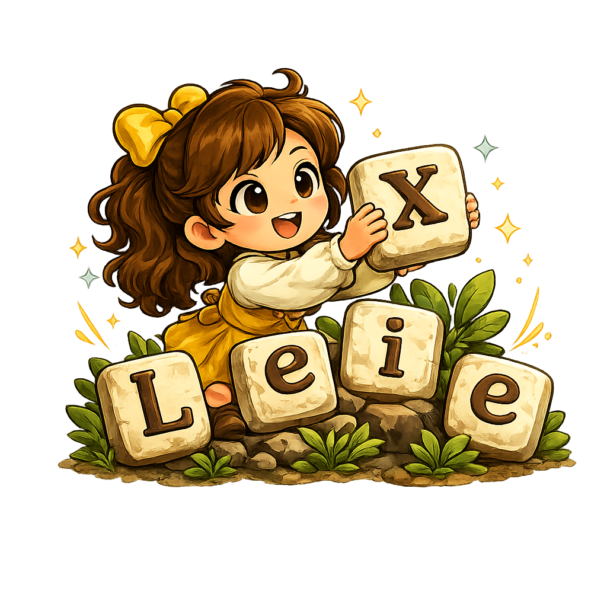

<p align="center">
  
</p>

# lexie

[](https://hex.pm/packages/lexie)
[](https://lexie.hexdocs.pm/)
[](https://github.com/peregrinefinch/lexie/actions/workflows/test.yml)

Generate Pooka lexers, source spans and syntax highlighters from TOML.

```sh
pooka add lexie --dev
pooka add poke --dev
pooka run -m lexie init
pooka run -m lexie
```

`init` creates an ignored `.lexie/lexie.toml`; running lexie writes the generated Pooka modules. In a project called `language`, the generated modules need only the standard library:

After generating the modules, put this in `test/lexer.spec.pooka`:

```pooka
module lexer_test

import language/syntax/lexer
import language/syntax/token
import poke/should
import pooka/list

test "recognises a keyword" {
  let tokens = lexer.lex("let") |> list.map(fn(lexeme) { lexeme.token })
  should.equal(tokens, [token.Let(), token.End()])
}
```

See the [guide](https://lexie.hexdocs.pm/guide.html) for the specification, and the [API documentation](https://lexie.hexdocs.pm/) for the rest.

## Licence

Licensed under the [Apache License, Version 2.0](LICENSE).
